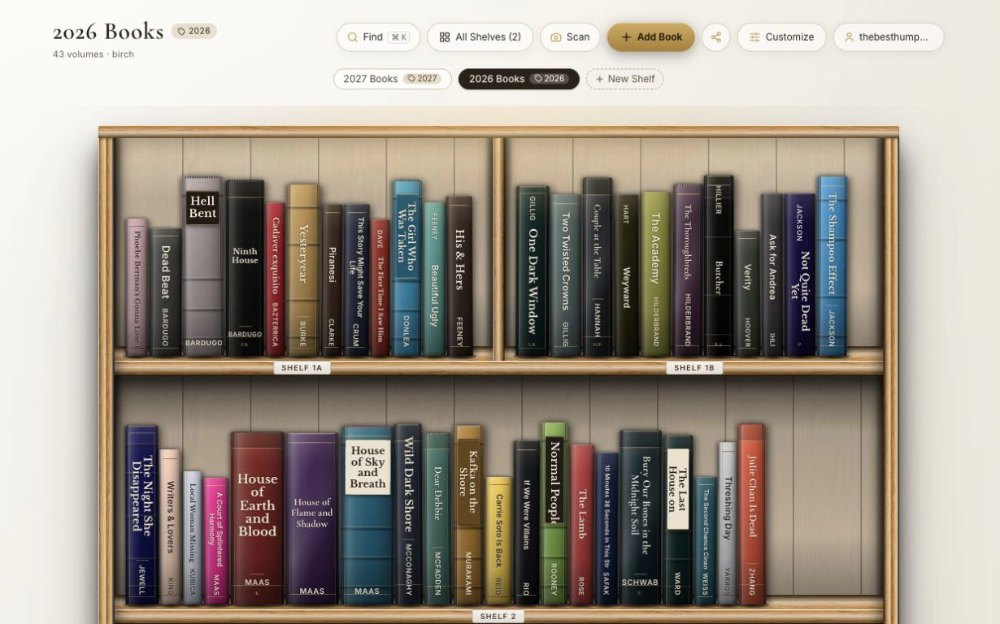

# The Virtual Bookshelf

I built The Virtual Bookshelf to keep track of the books on my physical shelves. On screen, a thick hardcover has room for its title to run across the spine. A slim paperback carries its title lengthwise. You can pull either one out, turn it over, and put it back where you’ll remember it.

[Open the live bookshelf](https://honeybooks.138.2.168.194.sslip.io/)



## Around the bookcase

- **Arrange a shelf.** Drag books between compartments. Right-click a spine to lean a book, lay it flat, or display the cover. Each case has its own layout, wood finish, and room theme, and you can sort it by title, author, author surname, height, or spine color.
- **Find a book you own.** Press <kbd>⌘</kbd>+<kbd>K</kbd> or <kbd>Ctrl</kbd>+<kbd>K</kbd>, search for a title, then choose **Show on shelf** to see its compartment and position from the left. On a phone, tap the bookcase map or swipe between compartments.
- **See what you’ve been reading.** The spotlight below the bookcase highlights finished books, four- and five-star reads, or books with notes while keeping each spine in place.
- **Share or back up the collection.** **Share shelf** saves a bookcase as a PNG. The account menu exports the whole library as JSON and can restore the shelves as copies.

## Inside a book

Click a spine and drag the book to rotate it through 360°. The inspector shows the cover, spine, and back at the edition’s proportions. In **Details**, you can check the publisher, ISBN, and dimensions, mark your reading progress, leave a star rating, or jot down a favorite passage. Dimensions are labeled as estimates when the catalog lacks measurements.


Use **Spine & Cover** to change the binding or artwork and **Shelf Position** to move the book to another compartment or bookcase.

## Add your books

Use **Add Book** to search Google Books and Open Library by title, author, or ISBN, or enter an edition by hand.

To import a physical shelf, choose **Scan Photo** and upload a photo of one or two rows. The app sends a resized image to Gemini to read the spines, then looks up matching editions. Review the matches, correct any titles, and choose **Keep photo layout** to assign each row to a compartment before adding the books. Scanning requires `GEMINI_API_KEY`.

## Run it locally

### Docker

```sh
docker compose up -d --build
```

Open [http://localhost:5173](http://localhost:5173) and create an account. You can start with an empty shelf or load the sample books. The Compose setup runs the frontend and API in one container and stores the SQLite database and uploaded images in a Docker volume.

Optional settings can go in a root `.env` file. `APP_PORT` changes the host port. `GOOGLE_BOOKS_API_KEY` is optional for catalog search. `GEMINI_API_KEY` enables photo scanning, and `GEMINI_MODEL` overrides the default model. If serving it through an HTTPS reverse proxy, set `FRONTEND_ORIGIN` to the public URL and `COOKIE_SECURE=true`.

### Development

Use Node.js 22.12 or newer and npm.

```sh
npm ci
[ -f backend/.env ] || cp backend/.env.example backend/.env
npm run build --workspace=packages/shared
touch backend/prisma/dev.db
npm run db:push
npm run dev
```

Vite serves the frontend at [http://localhost:5173](http://localhost:5173) and proxies requests to Fastify on port 3001. Put optional API keys in `backend/.env` for local development.

Run `npm test` for unit, API, and component tests. For browser tests, install Chromium with `npx playwright install chromium`, then run `npm run test:e2e`.

The app uses React and CSS 3D for the bookcase, Fastify and Prisma for the API, and a shared TypeScript workspace for edition data and sizing. [Architecture notes](docs/ARCHITECTURE.md)
