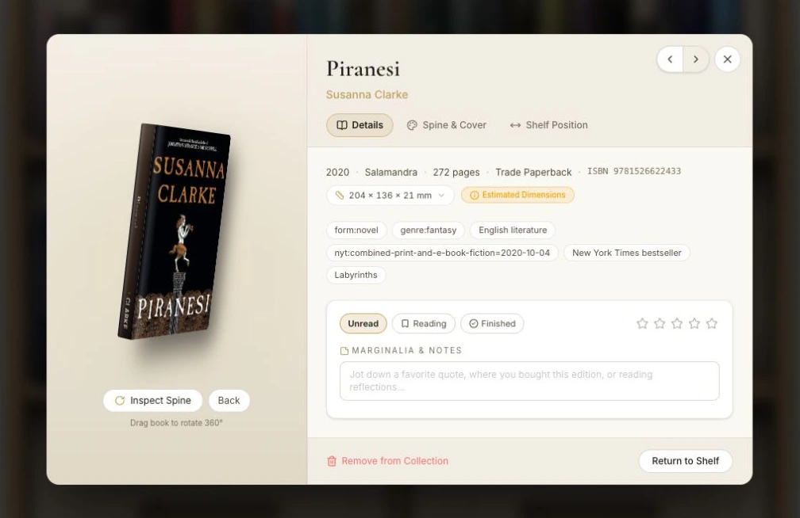

# The Virtual Bookshelf

A hobby project for keeping track of the books on my physical shelves. I wanted to see the books spine-out, move them around, and pull one off the shelf to look at it.


## What you can do

- Keep several bookcases and give each its own layout, wood finish, and room theme. Drag books between compartments or arrange an entire bookcase by title, author, author surname, height, or spine color.
- Find editions by title, author, or ISBN using Google Books and Open Library, or enter a book by hand. Press <kbd>⌘</kbd>+<kbd>K</kbd> or <kbd>Ctrl</kbd>+<kbd>K</kbd> to find a book you already shelved.
- In Find, choose **Show on shelf** for the bookcase, compartment, and position from the left, or **Open details** to inspect the book. On phones, tap the bookcase map or swipe to switch compartments.
- On phones, open the top-right menu to customize or share a shelf.
- Click a spine to turn the book in 3D, check its edition and dimensions, or record reading status, a rating, and notes. The app estimates dimensions when the catalog doesn't supply them.
- Use **Share shelf** to save a bookcase as a PNG. The account menu can export your library as a JSON backup and restore the shelves as copies.



### Import from a shelf photo

In **Add Book → Scan Photo**, upload a photo of one or two rows. Gemini reads the spines, then the app looks for catalog matches. You can review the matches, fix titles, and choose what to add. **Keep photo layout** lets you pick a compartment for each detected row.

Photo scanning sends the resized image to Gemini and requires `GEMINI_API_KEY`. You can leave the key unset if you only use catalog search or manual entry.

## Run it locally

### Docker

```sh
docker compose up -d --build
```

Open [http://localhost:5173](http://localhost:5173) and create an account. You can start with an empty shelf or load the sample books. The Compose setup runs the frontend and API in one container and stores the SQLite database and uploaded images in a Docker volume.

Optional settings can go in a root `.env` file. `APP_PORT` changes the host port. `GOOGLE_BOOKS_API_KEY` is optional for catalog search. `GEMINI_API_KEY` enables photo scanning, and `GEMINI_MODEL` overrides the default model. If serving it through an HTTPS reverse proxy, set `FRONTEND_ORIGIN` to the public URL and `COOKIE_SECURE=true`.

### Development

Use Node.js 22.12 or newer and npm.

```sh
npm ci
[ -f backend/.env ] || cp backend/.env.example backend/.env
npm run build --workspace=packages/shared
touch backend/prisma/dev.db
npm run db:push
npm run dev
```

Vite serves the frontend at [http://localhost:5173](http://localhost:5173) and proxies requests to Fastify on port 3001. Put optional API keys in `backend/.env` for local development.

Run `npm test` for unit, API, and component tests. For browser tests, install Chromium with `npx playwright install chromium`, then run `npm run test:e2e`.

The app uses React and CSS 3D on the frontend, Fastify and Prisma on the backend, and a shared TypeScript workspace. See [the architecture notes](docs/ARCHITECTURE.md) for the project layout and rendering choices.
