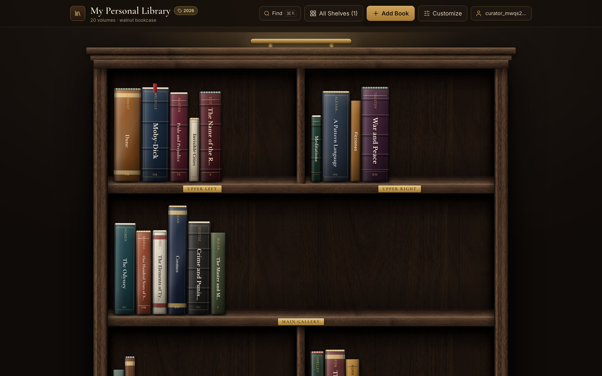
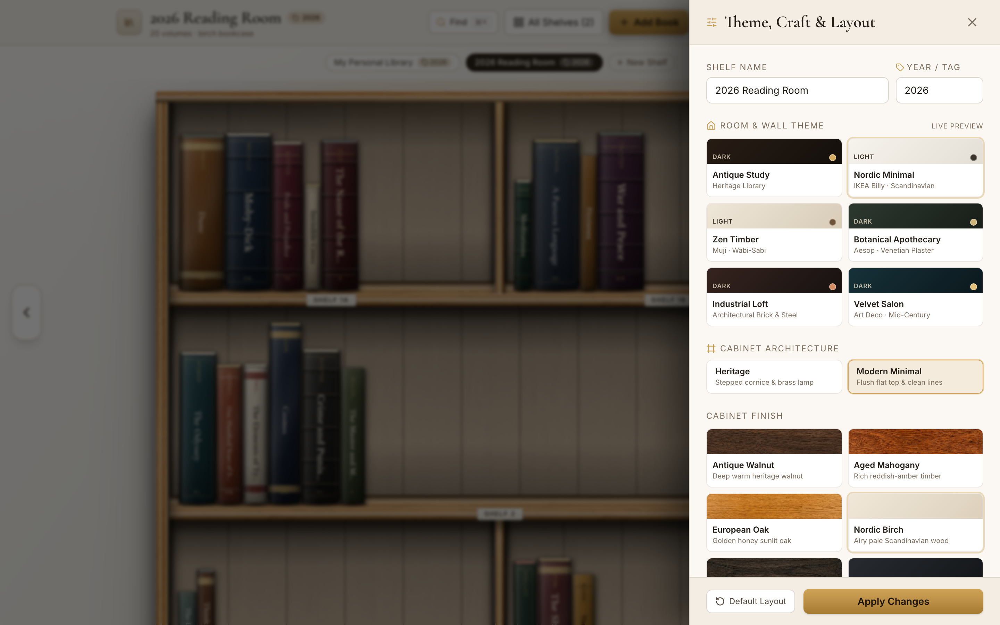
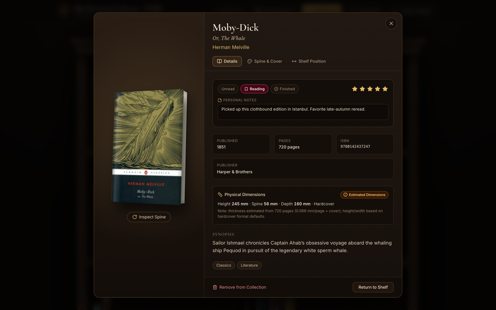
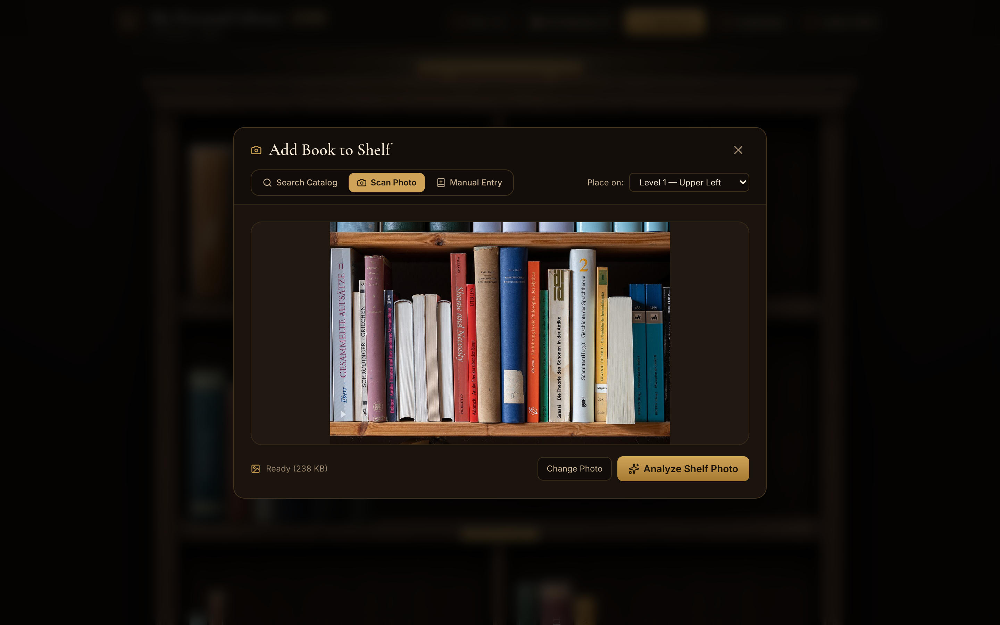
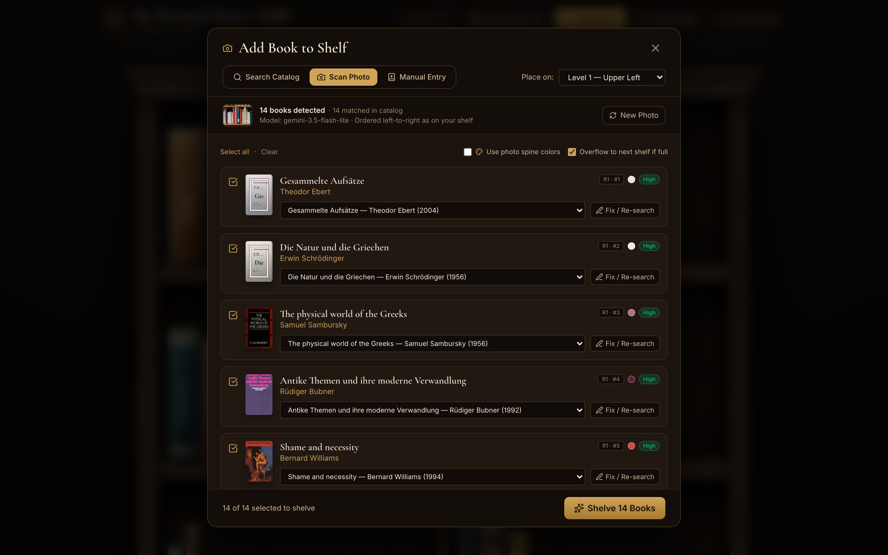
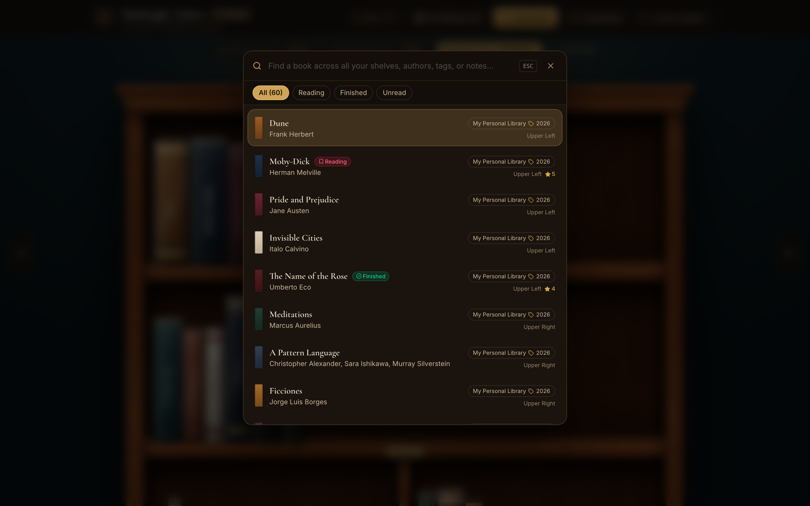

<div align="center">

# 📚 The Virtual Bookshelf

**A personal hobby project — a cozy, tactile virtual bookcase for the web.**  
No spreadsheets or cluttered reading trackers: just real book proportions, wood & linen bindings, 3D cover reveals, interior room themes, and snapping a photo of your real shelf to bring it online.

<p>
  
  
  
  
  
</p>

<br />



<p><em>Books rendered to real-world height and spine thickness—with cloth &amp; leather textures, raised ribs, engraved brass plaques, gallery lighting, and a crimson silk bookmark ribbon on your current read.</em></p>

</div>

---

## 👋 Why This Exists

This is a **personal hobby project** built for fun to have a nicer place to keep track of physical books—something that actually feels like standing in front of a wooden bookcase rather than scrolling through a database table. It's self-hosted, private, runs in a single Docker container with SQLite, and works smoothly on both desktop and mobile.

---

## ✨ The Fun Stuff

### 🏛️ Multiple Bookcases, Rooms & 3D Book Reveals
Keep separate shelves for reading years (`2026`, `2025`), genres, or moods—then zoom out to **All Shelves** to see miniature live previews of every bookcase and drag-and-drop their order.


<br />

<table>
  <tr>
    <td width="50%" valign="top">
      
      <p align="center"><strong>6 Interior Rooms &amp; 2 Cabinet Styles</strong><br />Switch live between ornate <em>Heritage</em> cornices and flush <em>Modern Minimal</em> (IKEA Billy / Muji) frames, 6 wood finishes, custom shelf rows/compartments, and one-click auto-arrange by title, author, height, or color spectrum.</p>
    </td>
    <td width="50%" valign="top">
      
      <p align="center"><strong>3D Book Reveal &amp; Reading Life</strong><br />Pull any book off the shelf to inspect its 3D cover and cream paper fore-edges, check verified vs. estimated dimensions, set reading status &amp; 5-star rating, jot down personal notes, or customize its spine/cover.</p>
    </td>
  </tr>
</table>

<br />

### 📸 Snap a Real Shelf Photo, Shelve the Whole Row *(Optional AI)*
Adding 50 physical books one by one is tedious, so you can just take a photo of your real bookcase under **Add Book → Scan Photo**:

- Your browser resizes the photo locally before uploading to keep things fast and lightweight.
- **Gemini Flash-Lite** reads the spines top-to-bottom, left-to-right (even mixed-language shelves, skipping backwards or unreadable books), estimates each spine's real color, and matches editions against Google Books & Open Library.
- A review screen shows confidence badges (`High` / `Check` / `Low`), automatically unchecks books already `In Library`, lets you swap editions or fix a misread title with zero extra AI calls, optionally keeps the photo's real spine colors, and shelves the whole batch in photo order (overflowing to the next shelf if one fills up).

<table>
  <tr>
    <td width="50%" valign="top">
      
      <p align="center"><strong>1. Drop a Real Shelf Photo</strong><br />Auto-compressed locally (<code>238 KB</code>) before sending to Gemini Flash-Lite to stay fast and free-tier friendly.</p>
    </td>
    <td width="50%" valign="top">
      
      <p align="center"><strong>2. Review &amp; Batch Shelve</strong><br />Live result: 14 of 14 readable spines matched left-to-right with real covers, spine color dots, confidence badges, and one-click shelving.</p>
    </td>
  </tr>
</table>

> **Note:** `GEMINI_API_KEY` is **completely optional**. If you don't configure a key, the entire app works normally—only the **Scan Photo** tab stays disabled with a short setup notice.

<br />

### ⌘K Instant Search Across Every Shelf
Hit `⌘K` (`Ctrl+K`) anywhere to search across all your bookcases by title, author, tag, notes, or reading status (`Reading`, `Finished`, `Unread`) and jump straight to the book.



<br />

### Other Nice Touches
- **Tactile Drag & Drop:** Drag books smoothly across shelves and compartments (with real shelf-width capacity checks and keyboard accessibility).
- **Real Book Discovery:** Search by title, author, or ISBN via Google Books with automatic fallback to Open Library, edition picker, cover-to-spine color extraction, and manual entry.
- **Private & Self-Hosted:** Simple username/password accounts (`crypto.scrypt` + HTTP-only cookies) backed by a single SQLite file—no external database or cloud lock-in.

---

## 🚀 Running It Yourself

### Option 1: Docker (Easiest)
Runs the Fastify API, SQLite database (on a persistent Docker volume), and built React frontend in one container:

```bash
# Launch on http://localhost:5173 (no API keys required!)
docker compose up -d --build
```

Optional API keys (both are optional—leave them out if you don't need them):

```bash
# Add GEMINI_API_KEY only if you want the Scan Photo feature
APP_PORT=8088 \
GOOGLE_BOOKS_API_KEY="optional-google-books-key" \
GEMINI_API_KEY="optional-gemini-api-key" \
docker compose up -d --build
```

- `GEMINI_API_KEY` *(optional)* — enables **Scan Photo** using Gemini Vision. Omit it and the rest of the app works normally.
- `GEMINI_MODEL` *(optional, default `gemini-3.5-flash-lite`)* — override the Gemini model if desired.
- Behind an HTTPS reverse proxy (Nginx/Caddy/Traefik), set `COOKIE_SECURE=true` and `FRONTEND_ORIGIN=https://your-domain` (see [docker-compose.oracle.yml](docker-compose.oracle.yml)).

### Option 2: Local Development
Requires **Node.js `>= 20`** and **npm `>= 10`**.

```bash
npm install
npm run build --workspace=packages/shared
npm run db:generate
npm run db:push
npm run dev
```

Open **http://localhost:5173**, create an account (with optional starter classics), and start shelving.

---

## 🛠️ Project Layout & Scripts

| Command | Description |
| :--- | :--- |
| `npm run dev` | Run Fastify backend (`:3001`) and Vite frontend (`:5173`) concurrently |
| `npm run build` | Type-check and compile `packages/shared`, `backend`, and `frontend` |
| `npm run typecheck` | Run TypeScript checks across all workspaces |
| `npm test` | Run Vitest unit, API integration, and frontend component tests |
| `npm run test:e2e` | Run Playwright end-to-end tests |

```text
bookshelf/
├── packages/shared/   # Shared DTOs, Zod schemas, themes, ISBN validator, dimension & spine engines
├── backend/           # Fastify 5 API, Prisma + SQLite, scrypt auth, book search, cover proxy & Gemini shelf scanner
├── frontend/          # React 19 + Vite + Tailwind CSS v4, CSS 3D Bookshelf/Book UI, dnd-kit
├── e2e/               # Playwright end-to-end tests
└── docs/              # Architecture notes & screenshots
```

See [docs/ARCHITECTURE.md](docs/ARCHITECTURE.md) if you're curious about the CSS 3D vs. Three.js tradeoffs and architecture notes.
