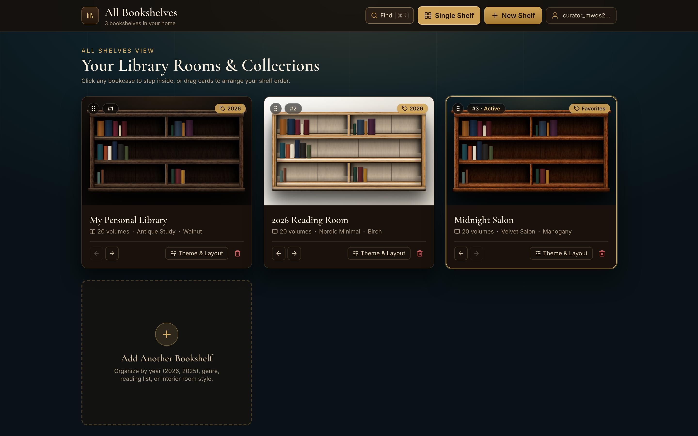

<div align="center">

# 📚 The Virtual Bookshelf

**A tactile, architectural personal library for the web.**  
Real-world book proportions, hand-crafted bindings, 3D cover reveals, interior room themes, and physical drag-and-drop shelving.

<p>
  
  
  
  
  
</p>

<br />


<p><em>Antique Study walnut bookcase with brass gallery lighting, engraved plaques, cloth &amp; leather spines, and a crimson silk bookmark ribbon on your current read.</em></p>

</div>

---

## ✨ Visual Tour

### 🏛️ Multi-Shelf Mission Control & Interior Room Themes
Organize your library across dedicated bookshelves—by reading year (`2026`, `2025`), genre, or mood. Step back into the **All Shelves** Mission Control gallery with live miniature bookcase previews and drag-and-drop shelf ordering.



<br />

<table>
  <tr>
    <td width="50%" valign="top">
      
      <p align="center"><strong>6 Interior Rooms &amp; 2 Cabinet Silhouettes</strong><br />Switch seamlessly between ornate <em>Heritage</em> cornices and flush <em>Modern Minimal</em> (IKEA Billy / Muji) frames with adaptive light &amp; dark UI surfaces.</p>
    </td>
    <td width="50%" valign="top">
      
      <p align="center"><strong>Interactive 3D Cover Reveal &amp; Reading Life</strong><br />Pull any volume from the shelf to inspect its 3D cover, cream paper fore-edges, verified/estimated dimensions, reading status, 5-star rating, and personal marginalia.</p>
    </td>
  </tr>
</table>

<br />

### ⌘K Instant Library Search
Find any volume across all your bookshelves in milliseconds—filter by title, author, shelf tag, notes, or reading status (`Reading`, `Finished`, `Unread`) and jump straight to its spine.


---

## 🎯 Craft & Capabilities

| Pillar | What's Inside |
| :--- | :--- |
| **Physical 3D Book Rendering** | Variable heights & spine thicknesses driven by verified publisher measurements or transparently labeled page-count estimates. Cylindrical spine lighting, French-joint hinge grooves, raised leather ribs, stitched silk headbands, and a crimson silk bookmark ribbon for books you're currently reading. |
| **Architectural Rooms & Finishes** | 6 interior room themes (*Antique Study*, *Nordic Minimal*, *Zen Timber*, *Botanical Apothecary*, *Industrial Loft*, *Velvet Salon*), 6 wood/cabinet finishes (*Walnut*, *Mahogany*, *European Oak*, *Nordic Birch*, *Smoked Espresso*, *Matte Charcoal*), and selectable **Heritage** vs. **Modern Minimal** cabinet architecture. |
| **Customizable Shelf Structure** | Configure 1–6 shelf levels, split any row into 1–3 compartments, dial in shelf heights, engrave custom plaques, and one-click **Auto-Arrange** by title, author, height, or color spectrum. |
| **Tactile Drag & Drop** | Smooth `dnd-kit` drag-and-drop across compartments and between shelf cards in Overview, with real-time shelf capacity validation and full keyboard accessibility. |
| **Real Book Discovery** | Search by title, author, or ISBN via Google Books API with automatic circuit-breaker failover to Open Library, edition picker, duplicate detection (`In Library`), batch shelving, cover-to-spine palette extraction, custom cover/spine uploads, and manual cataloging. |
| **Private Multi-User Accounts** | Self-hosted SQLite storage, `crypto.scrypt` password hashing, HTTP-only session cookies, login rate limiting, and per-user isolated libraries. |

---

## 🚀 Quick Start

### Option 1: Docker (Recommended)
Run the complete production stack (Fastify API, SQLite database on a persistent Docker volume, and compiled React frontend) in a single container:

```bash
# Build and launch on http://localhost:5173
docker compose up -d --build

# Check health & logs
docker compose ps
docker compose logs -f bookshelf
```

Override the host port or supply an optional Google Books API key:

```bash
APP_PORT=8088 GOOGLE_BOOKS_API_KEY="your-key" docker compose up -d --build
```

> **HTTPS Reverse Proxy Note:** When deploying behind TLS (Nginx, Caddy, Traefik), set `COOKIE_SECURE=true` and `FRONTEND_ORIGIN=https://your-domain`. See [docker-compose.oracle.yml](docker-compose.oracle.yml) for a production reverse-proxy example.

### Option 2: Local Development
Requires **Node.js `>= 20`** and **npm `>= 10`**.

```bash
# 1. Install workspace dependencies
npm install

# 2. Build shared package & initialize SQLite database
npm run build --workspace=packages/shared
npm run db:generate
npm run db:push

# 3. Start backend (:3001) & frontend (:5173) concurrently
npm run dev
```

Open **http://localhost:5173**, create an account (optionally pre-stocked with classic editions), and start curating your library.

---

## 🛠️ Scripts & Project Structure

| Command | Description |
| :--- | :--- |
| `npm run dev` | Run Fastify backend (`:3001`) and Vite frontend (`:5173`) concurrently |
| `npm run build` | Type-check and compile `packages/shared`, `backend`, and `frontend` |
| `npm run typecheck` | Run TypeScript checks across all workspaces |
| `npm test` | Run Vitest unit, API integration, and frontend component tests |
| `npm run test:e2e` | Run Playwright end-to-end tests across desktop and mobile viewports |

```text
bookshelf/
├── packages/shared/   # Shared DTOs, Zod schemas, themes, ISBN validator, dimension & spine engines
├── backend/           # Fastify 5 REST API, Prisma ORM + SQLite, scrypt auth, search & cover proxy
├── frontend/          # React 19 + Vite + Tailwind CSS v4, CSS 3D Bookshelf/Book UI, dnd-kit
├── e2e/               # Playwright end-to-end tests
└── docs/              # Architecture notes & showcase screenshots
```

See [docs/ARCHITECTURE.md](docs/ARCHITECTURE.md) for architectural decisions, the CSS 3D vs. Three.js evaluation, external API tradeoffs, and known limitations.
